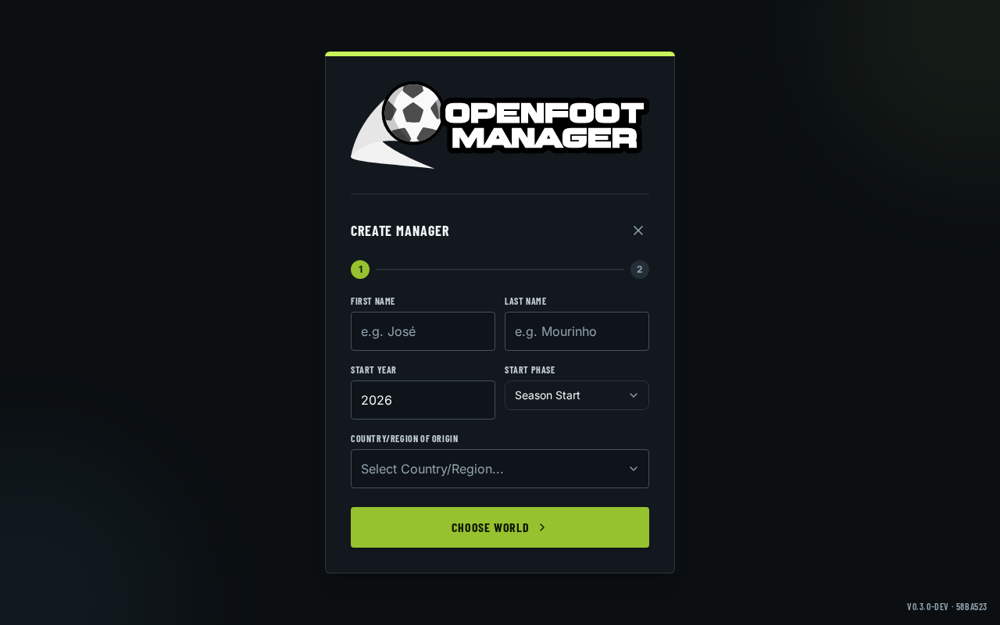
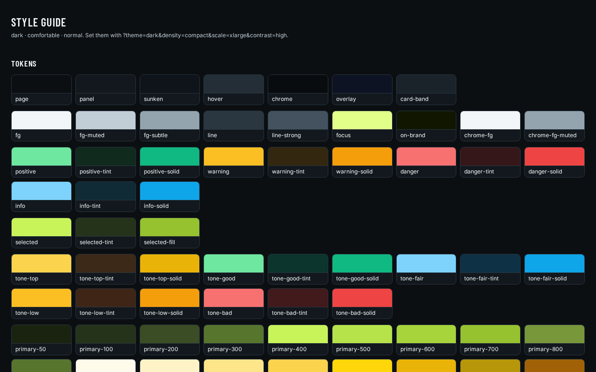

<div align="center">


# Openfoot Manager

**A free, open-source football management simulation that runs entirely on your own machine.**

[](LICENSE.md)
[](https://github.com/jawad1020bhn/the-gaffer-v0.4/releases/latest)
[](https://www.rust-lang.org/)
[](https://tauri.app/)
[](https://react.dev/)

[Download](#download--play) • [What's in the game](#whats-in-the-game) • [World data](#world-data) • [Screenshots](#screenshots) • [Build from source](#build-from-source) • [Docs](#documentation) • [Contributing](#contributing)

</div>

---

## What this is

You are the football manager. You pick the squad, set the tactics, negotiate the transfers, answer
to the board, and live with the results. Matches simulate in text with event-driven commentary,
seasons roll forward, players develop and age, and the world keeps moving without you.

There is **no account, no server, and no telemetry**. Your saves are files on your disk, in a
SQLite database you can open yourself. If this project vanished tomorrow, your career would keep
working exactly as it did yesterday.

It is **not a Football Manager clone**. The genre is shared; the design is not. There is no
licensed database bundled into the engine, no online requirement and no monetization. Instead the
world is *data you author and share*, and the depth is a dial you set. [VISION.md](VISION.md)
explains what the project is for and what it deliberately refuses to do.

> **About this repository.** This is a fork of
> [openfootmanager/openfootmanager](https://github.com/openfootmanager/openfootmanager), carrying
> its own UI direction and an optional real-world data package. Upstream is the original project
> and still where the shared roadmap lives. See [Credits](#credits--license) for attribution.

## Download & play

Grab the newest build from the **[Releases page](https://github.com/jawad1020bhn/the-gaffer-v0.4/releases/latest)**.

### Windows — portable, nothing to install

Download `OpenfootManager-portable-windows-x64.zip`, unzip it anywhere, and run
`OpenfootManager.exe`. That's the whole installation.

| | |
|---|---|
| **Runtime needed** | Microsoft Edge WebView2 — already part of Windows 10 and 11 |
| **First launch** | SmartScreen will warn once, because the binary is not code-signed. *More info → Run anyway* |
| **Where saves live** | `%APPDATA%\com.sturdyrobot.openfootmanager` |
| **Uninstall** | Delete the folder. Delete the path above too if you want your saves gone |

The zip contains the executable, a `data/` folder with the name and nation pools it generates
players from, and `packages/` with the EA FC 27 world it starts a career on (see below).

### Linux and macOS

Build from source — see [Build from source](#build-from-source). Linux renders through WebKitGTK,
which has known trouble with NVIDIA's proprietary driver; the app picks a rendering path at
startup, and [docs/LINUX_GRAPHICS.md](docs/LINUX_GRAPHICS.md) documents the `OFM_GPU_PROFILE`
override if you get a blank window.

## What's in the game

The interface is a dark, broadcast-style command centre. A persistent strip keeps your club, the
date, the next fixture, unread mail and your budget in view, and a single command bar at the bottom
handles **Continue**, match mode and saving. Nineteen destinations are grouped into five sections:

| Section | Destinations |
|---|---|
| **Career** | Home · Manager |
| **Team** | Squad · Tactics · Training · Staff · Youth Academy |
| **Transfers** | Transfers · Transfer Centre · Scouting · Players |
| **Competitions** | Schedule · Tournaments · Teams · Managers · Hall of Fame |
| **Office** | Inbox · News · Finances |

Underneath that:

- **Match day, end to end** — pre-match setup and lineup, live text simulation with speed controls,
  half-time team talk, substitutions, post-match analysis and a press conference. Penalty
  shootouts have their own kick sheet and order picker.
- **Squad and tactics** — formations, play styles, set-piece takers, roles, depth planning, player
  condition and traits, drag-to-swap lineups on a pitch view.
- **Transfers and contracts** — bids, counter-offers, loans, free agents, renewals and a
  negotiation history, with a transfer centre for the deals in flight.
- **Training and staff** — training focus, intensity and schedules; coaching staff who affect it.
- **Youth academy** — intake, potential and growth.
- **A world that reacts** — generated inbox mail and news, league tables, cup brackets, awards,
  a hall of fame, job opportunities and the sack.
- **Finances** — budgets, wages and cash flow.
- **Accessibility** — high-contrast mode, UI scale, and a **density** setting (comfortable or
  compact) so the same screens work on smaller displays.
- **English**, with every player-facing string behind a translation key. Arabic is shown in the
  language picker as *coming soon*.

New to the game? [docs/GETTING_STARTED.md](docs/GETTING_STARTED.md) walks a first career from
creating your manager to surviving your first match day.

## World data

The engine ships **no licensed football data**, but this fork ships a world beside it, so there
is nothing to import before you play.

**1. The default: EA FC 27.** [`mods/eafc-fc27`](mods/eafc-fc27/README.md) is an unofficial
database of **684 clubs, 18,875 player rows and 38 competitions**, imported by
[`tools/eafc-import`](tools/eafc-import/README.md). **Every build ships it** — installer, portable
zip and `tauri dev` alike — in `packages/`, and the game installs and pre-selects it on first run,
so a new career starts with real clubs instead of generated ones. There is no import step.

**2. Generated worlds.** Untick the package on the new-game screen and the game creates clubs,
players, competitions and past seasons from editable name and nation pools. Fully fictional, no
legal strings, and yours to reshape. Nothing was removed to make the real database the default.

> **Read this before using the FC 27 package.** It is unofficial and unaffiliated with EA. The
> data belongs to EA — keep it for personal use. It is a *mod*, not part of the engine, precisely
> because upstream ships no licensed data on purpose. Shipping it as the default is this fork's
> decision and diverges from [VISION.md](VISION.md); if you redistribute a build, read that
> document and EA's terms first. It is also not season-ready: 20 clubs have
> no competition membership, 1,877 contracts expire before the 2027 base year, and wages and
> goalkeeper weak-foot values are incomplete. There are no national teams or real staff.
> [DATA_QUALITY.md](mods/eafc-fc27/DATA_QUALITY.md) lists every correction and remaining gap.

A 684-club world is slow to build the first time because the selector also generates past seasons
(12 years by default). Choose **None** or **6 years** for a much faster first load; the history is
cosmetic.

Worlds are `.ofm` packages you can author, pack, validate and share. See
[docs/modding](docs/modding).

## Screenshots

The current shell — the new-game wizard and the design tokens every screen is built from:

<a href="docs/roadmap/evidence/menu-1280x800.png"></a>
<a href="docs/roadmap/evidence/style-guide-1280.png"></a>

**Gameplay gallery — older 0.3.x interface.** These show the depth of the simulation, but they
predate the redesign: they still have the left sidebar, the theme toggle and the old green palette.
They have not been re-captured yet.

<a href="images/screenshots/manage_squad.png"></a>
<a href="images/screenshots/matchlive.png"></a>
<a href="images/screenshots/inbox.png"></a>

<a href="images/screenshots/training.png"></a>
<a href="images/screenshots/news.png"></a>
<a href="images/screenshots/presstalk.png"></a>

## How it's built

A **Tauri** desktop shell around a **Rust** simulation engine, with a **React + TypeScript** front
end styled by **Tailwind**, persisting to **SQLite**.

The Rust side is a workspace whose crates depend in one direction, so the rules of football have
exactly one home and the UI cannot quietly reinvent them:

```
domain  →  engine  →  ofm_core  →  src-tauri (Tauri commands)  →  React
```

| Crate | Responsibility |
|---|---|
| `domain` | Core types and rules — entities, ages, validation |
| `engine` | Match simulation |
| `ofm_core` | World generation, packages, season and career logic |
| `db` | SQLite persistence |
| `src-tauri` | The Tauri app and its IPC command surface |
| `ofm-cli` | Authoring CLI: pack and validate `.ofm` packages |
| `sim-bench`, `season-harness`, `mcp-results`, `mcp-e2e` | Simulation benchmarks and test harnesses |

The front end talks to Rust over Tauri IPC and keeps view state in Zustand stores. Colour, spacing,
radius and type come from design tokens in `src/App.css`, enforced by tests rather than review —
see [docs/DESIGN_SYSTEM.md](docs/DESIGN_SYSTEM.md).

There is also an optional **MCP server** (`mcp` Cargo feature) that lets AI agents play the game
through a text interface and compete against each other. Normal builds are unaffected. See
[docs/MCP_SERVER.md](docs/MCP_SERVER.md).

[docs/ARCHITECTURE.md](docs/ARCHITECTURE.md) has the full command reference and data-flow diagrams.

## Build from source

### Prerequisites

1. **Rust 1.95.0** — installed via `rustup`. The version is pinned in `rust-toolchain.toml`, so
   rustup selects it automatically.
2. **Node.js 20 or newer** — the release workflows build on 24.
3. **Tauri's platform dependencies** for your OS — follow the
   [Tauri prerequisites guide](https://v2.tauri.app/start/prerequisites/).

### Run it

```bash
git clone https://github.com/jawad1020bhn/the-gaffer-v0.4.git
cd the-gaffer-v0.4
npm ci
npm run tauri dev
```

`npm run dev` starts only the Vite front end. That is useful for styling work, but it has **no
Tauri backend**, so anything needing a career will not load — use `npm run tauri dev` to play.

The default world needs no setup. `mods/eafc-fc27` is packed into
`src-tauri/packages/eafc-fc27.ofm`, which Tauri ships as a resource and `tauri dev` reads in place.
`src-tauri/build.rs` does the packing, so **any** `cargo build`/`test`/`clippy` produces it — the
npm `predev`/`prebuild` hooks just cover the frontend-only paths. It is generated and gitignored;
`npm run world:pack` rebuilds it, and a run with unchanged data costs nothing. Unlike the fixture
below, the packer needs **no Rust** — but building the app now needs Node on PATH, which it
already did for `dist`.

### One wrinkle on a fresh checkout

`src/dev/pageHarness/fixture.generated.ts` is generated from the Rust side and deliberately not
committed. `npm test` and `npm run build` generate it automatically via a prehook, which means
**they need a working Rust toolchain**. To make it explicitly:

```bash
npm run fixture:pages
```

If you only want the front end and have no Rust, `npx vite build` and targeted
`npx vitest run <path>` work without it.

### Build a release binary

```bash
npx tauri build
```

For the same portable folder the Windows release ships — no installer, resources beside the
executable:

```bash
npx tauri build --no-bundle
cargo build --locked --release --manifest-path src-tauri/Cargo.toml -p ofm-cli
src-tauri/target/release/ofm-cli pack mods/eafc-fc27 --output eafc-fc27.ofm
src-tauri/target/release/ofm-cli validate eafc-fc27.ofm
```

Put the executable, `data/` and `packages/eafc-fc27.ofm` in one folder. That is exactly what
[`.github/workflows/windows-portable.yml`](.github/workflows/windows-portable.yml) does on a
Windows runner when a `portable-*` tag is pushed.

## Tests and quality gates

```bash
npm test                                    # front end (needs the Rust-generated fixture)
npm run audit:i18n                          # advisory scan for strings that bypass the catalogue
npm run lint                                # Biome
npm run format:check
cargo test --locked --manifest-path src-tauri/Cargo.toml --workspace
cargo clippy --manifest-path src-tauri/Cargo.toml --workspace --all-targets -- -D warnings
```

`npm run preflight` chains the front-end gates. CI also lints a second time with `--features mcp`,
so match that scope before calling a change clippy-clean.

Two test suites are worth knowing about: `src/designSystem.test.ts` enforces the token rules —
including repo-wide guards that fail if a raw Tailwind palette class reappears on any screen — and
`src/i18n` checks that every literal `t("…")` key exists in `en.json` and that the language
registry matches the files on disk.

## Project layout

```
src/                    React + TypeScript front end
  components/           One folder per screen family, plus ui/ primitives
  i18n/locales/         en.json — the whole string catalogue
  App.css               Design tokens
src-tauri/              Tauri app and the Rust workspace
  crates/               domain, engine, ofm_core, db, ofm-cli, harnesses
mods/eafc-fc27/         The default world, packed into src-tauri/packages on predev/prebuild
tools/eafc-import/      The importer that produced it
docs/                   Player guides and technical documentation
images/                 Logo and screenshots
scripts/                Build and audit helpers
```

## Documentation

**[docs/README.md](docs/README.md) is the full index.** The most useful entries:

| Document | What it covers |
|---|---|
| [VISION.md](VISION.md) | What the project is for, and what it refuses to be |
| [GETTING_STARTED.md](docs/GETTING_STARTED.md) | Player guide — your first career and match day |
| [ARCHITECTURE.md](docs/ARCHITECTURE.md) | Structure, crate graph, every IPC command |
| [GAME_SYSTEMS.md](docs/GAME_SYSTEMS.md) | How the simulation's systems work |
| [MATCH_SIMULATION.md](docs/MATCH_SIMULATION.md) | The match engine |
| [DESIGN_SYSTEM.md](docs/DESIGN_SYSTEM.md) | Tokens, roles and the rules tests enforce |
| [SAVE_SYSTEM_DESIGN.md](docs/SAVE_SYSTEM_DESIGN.md) | Persistence and compatibility |
| [docs/modding](docs/modding) | Authoring and sharing `.ofm` worlds |
| [LINUX_GRAPHICS.md](docs/LINUX_GRAPHICS.md) | WebKitGTK, NVIDIA and the GPU override |
| [MCP_SERVER.md](docs/MCP_SERVER.md) | Letting AI agents play |

Player guides are also translated: see `docs/BETA_TESTING_GUIDE_*.md`.

## Versioning

The project uses the odd/even convention:

- **Odd minors (`0.3.x`)** are the unstable stream, published as nightlies.
- **Even minors (`0.4.x`)** are stable releases.

So the number alone tells you what you're running. There are no `-beta` suffixes. The base version
lives in `src-tauri/tauri.conf.json` and is mirrored in `package.json` and the Cargo manifests; the
channel, commit and build date are injected at build time, so nothing needs editing per build.
A stable build shows `v0.4.1`; a development build shows `v0.4.1-dev · <sha>`.

## Contributing

Contributions are welcome. Read [CONTRIBUTING.md](CONTRIBUTING.md) first — it covers the workflow,
the lint baseline, lockfile policy and the release gate. [VISION.md](VISION.md) is the filter for
whether an idea belongs in the game at all.

The short version:

1. Open an issue before starting anything substantial.
2. Branch from `develop` and target it with your pull request.
3. Use a conventional-commit title.
4. Run the gates above. If you change a Cargo manifest, keep `Cargo.lock` in the same commit — CI
   builds with `--locked`.

## Credits & license

Openfoot Manager was created by **Pedrenrique G. Guimarães** and is developed by its contributors.
This repository is a fork of
[openfootmanager/openfootmanager](https://github.com/openfootmanager/openfootmanager); the game,
its engine and its vision are their work, and this fork's changes are built on top of it.

The **game** is free software under the **GNU General Public License v3** or later:

    Openfoot Manager - A free and open source soccer management game
    Copyright (C) 2020-2026  Pedrenrique G. Guimarães

    This program is free software: you can redistribute it and/or modify
    it under the terms of the GNU General Public License as published by
    the Free Software Foundation, either version 3 of the License, or
    (at your option) any later version.

    This program is distributed in the hope that it will be useful,
    but WITHOUT ANY WARRANTY; without even the implied warranty of
    MERCHANTABILITY or FITNESS FOR A PARTICULAR PURPOSE.  See the
    GNU General Public License for more details.

    You should have received a copy of the GNU General Public License
    along with this program.  If not, see <http://www.gnu.org/licenses/>.

See [LICENSE.md](LICENSE.md) for the full text.

**The GPL does not cover the optional EA FC 27 data package.** That data belongs to EA, is
unofficial, and is included as a personal-use mod — see [World data](#world-data).
