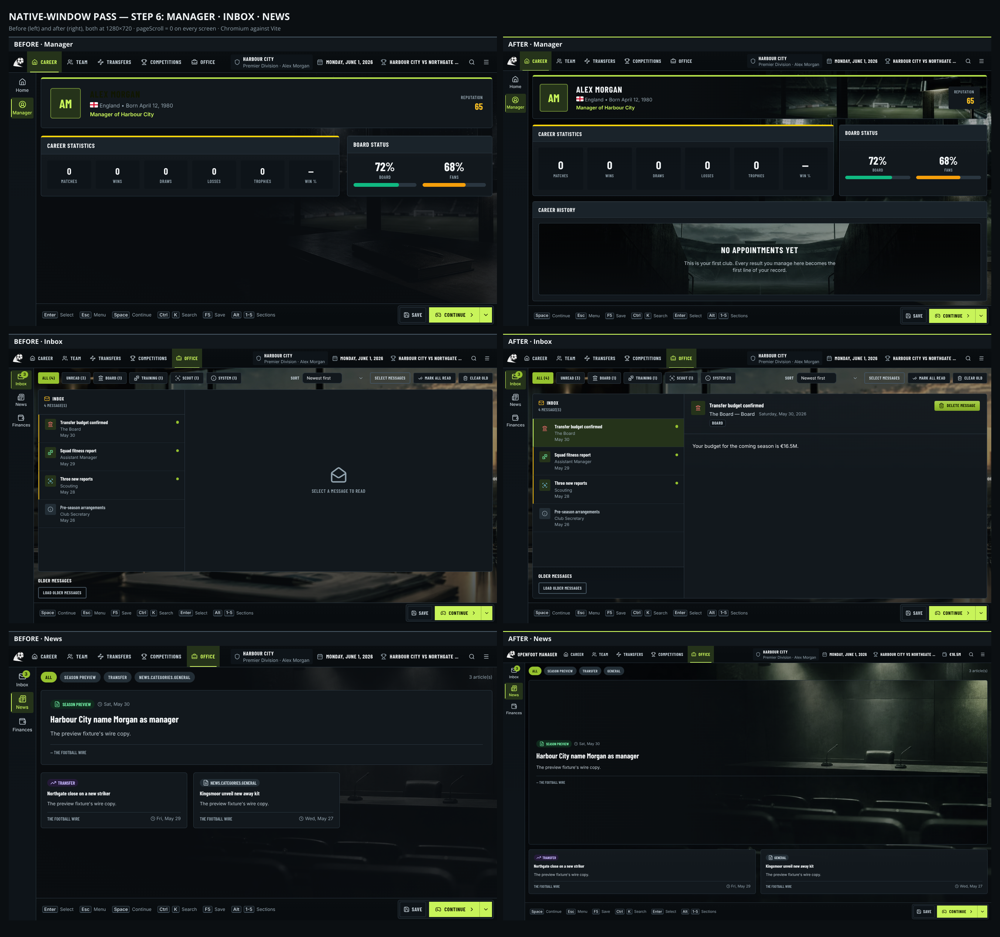

# Native-window pass — audit and status

Work order followed as given: audit → shell/window/scaling/hardening → Room → Panel → grid + Home.
**Steps 1–5 are done. Step 6 (the remaining screens) is not.** The list at the bottom is exact.

---

## 1. Audit (before any change)

Measured in headless Chromium on the shell preview career, 14 destinations × 4 resolutions
(1280×720, 1366×768, 1600×900, 1920×1080) = 56 states. Raw data:
[audit-report.json](ui-redesign/audit-report.json).

| Finding | Result |
| --- | --- |
| Page scroll (`scrollHeight > innerHeight`) | **0 everywhere** — the fixed canvas already held |
| Text below 11px | **0** at the old fixed 16px root |
| Truncated chrome | fixture chip (48×) — **has a tooltip, compliant**; `Keyboard shortcuts` (48×) — **real bug**, "Sections" rendered as "Sectio"; rail labels (16×) — wrap, not truncate |
| Raw i18n key | `NEWS.CATEGORIES.GENERAL` on News |
| Crashes | Teams, Youth Academy — **pre-existing**, preview fixture has no data for them |
| Home at 1280×800 | Recent Messages / Latest News / Unavailable Players / Board Objectives clipped mid-card; Player Momentum a crushed strip with dead space beside it |
| Bare empty states | Recent Results ("No matches played yet."), League Position |
| Rooms | present but crushed to near-black by an 82% wash |

The 960×640 single-column collapse was a consequence of `minWidth: 960` in the window config, not of
the layout: raising the minimum to 1280×720 removes the case entirely.

---

## 2. Shell, window, scaling, hardening — done

**Window** (`src-tauri/tauri.conf.json`): 1600×900 default, 1280×720 minimum, `resizable`, `center`.

**Scaling.** `html { font-size: clamp(14.667px, calc(100vw / 100 * var(--ui-scale, 1)), 22px) }`.
One rem of root per 100px of window: 16px at 1600, 19.2px at 1920. `--ui-scale` is the player's
setting (0.9375 / 1 / 1.125 / 1.25), set as a custom property so the formula lives in CSS once and
the webview re-evaluates it on resize with no listener.

> **The brief's example clamp was adjusted, deliberately.** `clamp(12px, 100vw/120, 18px)` puts the
> root at 12px on a 1280 window, which renders `caption` (0.75rem) at **9px** and `body` (0.875rem)
> at **10.5px** — both under the brief's own 11px/12px minimums. The floor is therefore 14.667px
> (11 / 0.75), which lands caption at exactly 11px and body at 12.83px. Consequence: below ~1467px
> of width the floor is in charge and `small` reads the same as `normal`. Cutting content is the
> answer to a tight window; shrinking type below the minimum is not. Asserted in `uiScale.test.ts`.

**Fixed canvas.** `html, body, #root`: `height: 100%`, `overflow: hidden`, `overscroll-behavior: none`.

**Hardening** (`src/lib/nativeChrome.ts`, installed in both entry points):

| Check | Verified |
| --- | --- |
| Chrome text not selectable (`user-select: none`) | ✅ |
| Browser context menu blocked | ✅ |
| F5 does not reload | ✅ |
| Ctrl+wheel / pinch blocked | ✅ |
| Ctrl+R blocked | ✅ |
| Image drag blocked | ✅ |
| F11 fullscreen (Tauri, DOM fallback) | implemented, not verified in a Tauri window |
| Fields keep selection, text cursor and their own menu | ✅ |

F5/Ctrl+K ownership is explicit: `useGameHotkeys` calls `setGameKeysOwned(true)` while it is
listening, so the hardening does not `preventDefault` them out from under it (which would have made
F5 save nothing, because `gameHotkeyFor` declines a `defaultPrevented` event). When no shell is
listening, the hardening swallows them instead.

**Hint bar** drops whole hints, lowest priority first, measured once and re-used on resize. All six
fit at 1280×720; nothing truncates mid-word at any of the four resolutions.

---

## 3. Room system — done

`SceneBackdrop` now layers: **plate → colour grade → vignette → readability scrim → grain**, over a
designed `room-fallback` gradient with a faint pitch grid, so a failed image degrades to a designed
surface rather than a void.

- **Brightness fixed.** The flat 82% wash is gone. The ambient scrim is a vertical gradient,
  26% page at the top → 70% at the bottom, and the plate grade went from `brightness(.86)` to
  `brightness(1.02) saturate(.72)`. Open areas now read as a place.
- **One palette.** `room-tint` applies a lime-teal cast in `mix-blend-mode: color`, which takes the
  room's hue and keeps its luminance.
- **Focal points** per room via `--room-focus` → `object-position`, so the subject survives every
  aspect ratio and the two salvaged banners keep their baked logo/lettering out of frame.
- **Formats.** AVIF → WebP → JPEG through `<picture>`. **16–54 KB per room in AVIF**, against a
  400 KB budget; all eleven total ~410 KB, down from 1.6 MB.
- **Crossfade** keyed on the plate with the fallback underneath, so no flash between rooms.
- **Prefetch** of the likely next rooms, once per session, opt-in per call site.
- Panels are `bg-panel-glass` (90% opaque) so the room's light survives under them.

---

## 4. Panel — done

`Card` / `CardHeader` / `CardBody` / **`CardFooter`** (new) is the one panel. Header gains a `count`
badge; body gains `scroll-fade`, a bottom mask so a continuing list reads as "more below" instead of
a card clipped mid-row; footer stays put while the body scrolls. Surfaces are the existing
`surface-panel` / `-well` / `-chrome` / `-brand` finishes with the three depth steps.

---

## 5. Grid + Home — done

Home is a 12-column grid with three `minmax(0, …fr)` row tracks that **fill the viewport exactly**:

- **Row 1** — Next Match hero (5 cols, art-headed) · Season Status (4) · League Position (3)
- **Row 2** — Getting Started (4) · Squad Overview (4, or 8 without a guide) · Recent Results (4)
- **Row 3** — Recent Messages · Latest News · Unavailable Players · Board Objectives (3 each)

Player Momentum is now a **footer line under Squad Overview**, not a fourth band. The fourth band
and the page scroll it caused are gone. Recent Results and League Position have designed,
atmospheric empty states with an action instead of a bare grey line.

**Verified at all four resolutions:** `pageScroll = 0`, no text under 11px, no footer overflow,
root 14.667 / 14.667 / 16 / 19.2px.

---

## 6. Screen reworks — Manager, Inbox, News, Finances done

### Manager — archetype D (profile)

`grid-cols-12 grid-rows-[auto_minmax(0,1fr)_minmax(0,1.4fr)]`: identity spans 12 as an **art-headed
hero** (`scene="career"`), career statistics 8 beside board/fan confidence 4, career history 12.

- **Name contrast fixed** — `text-on-brand` (dark lime on a dark room) → `text-fg`. This was the
  §10 "manager name dark-on-dark" bug.
- Reputation moved off the photograph into a `bg-panel-glass` well, so it is no longer text on art.
- The six stat wells stretch to fill their track and use `text-display`; the board and fan gauges are
  vertically centred rather than pinned to the top of a tall panel.
- Career history had no empty state at all — the panel was simply blank. It now fills with a
  `SceneState` over the empty-stadium plate: *"No appointments yet — this is your first club."*

**Trophy cabinet deliberately not built.** §4 asks for one, but the save only carries
`career_stats.trophies` — a count. There are no trophy names, seasons or competitions anywhere in the
data, so a cabinet would mean inventing both a feature and a save-format change. §12 forbids both.
The count stays in the stat row.

### Inbox — archetype B (master-detail)

- **Auto-opens the first unread**, falling back to the newest message, once per mount. The
  "Select a message to read" placeholder is gone (§6: master-detail never shows it).
- Root is `grid-rows-[auto_minmax(0,1fr)]`; list 4 cols, detail 8.
- **"Load older messages" is now above the fold** — `ArchivedMessages` moved into the list column
  inside a `max-h-52` contained scroll, instead of sitting under a full-height list.
- Removed `getListPaneClassName`'s fixed `md:w-96 md:min-w-[384px]` and its `hidden md:flex`
  collapse. That was a website's responsive sidebar: inside a grid track it left a blank vertical
  strip, and below `md` it hid the list entirely. The grid owns the width now and the window has a
  1280px minimum, so there is no narrow case to collapse for.

### News — archetype B, featured layout

One hero + four secondary (`PAGE_SIZE = 5`), rows `auto / 1fr / auto / auto`. The hero is an
**art-headed panel over the press room**, so a three-line wire item fills its track with atmosphere
instead of leaving 70% of a grey box empty. Secondary cards stay the height of their copy in a
2-up grid — stretching them just moved the emptiness into smaller boxes. The bare empty state is
now a `SceneState`.

### Finances — archetype A (dashboard)

Seven full-width sections used to stack into a scrolling page. Now: overview 8 + wage bill 4 on the
top row, and **cash flow / wage pressure / sponsors / facilities / payroll behind in-panel tabs**
below — §5's second overflow remedy. **Nothing was removed**; every section is one tab away.

The no-snapshot states are designed too: a **panel-shaped skeleton** while loading (not a spinner on
blank), and a full-height `SceneState` with the Retry action if the snapshot fails.

### Chart labels were under the 11px floor

Bringing `manager/` and `finances/` up to the strict design-system gate surfaced a real §1 violation:
Recharts writes its text sizes as **fixed-pixel SVG presentation attributes**, so axis ticks were
drawn at **9px** and legends at 10px, and none of them followed `ui_scale`.

Fixed centrally rather than per chart: `ChartContainer` now carries a `chart-surface` class and
`App.css` sets Recharts' tick, legend, label and tooltip text to `var(--text-caption)`. A CSS rule
outranks a presentation attribute, so this covers **every** chart in the app, including the ones in
folders that have not been reworked yet. The inline `fontSize` numbers are gone from
`ManagerCareerChart` and `FinanceCashFlowChart`.

`components/manager/`, `components/inbox/` and `components/finances/` have joined `FINISHED_FOLDERS`
in `src/designSystem.test.ts`, so the colour, type, radius, overlay and focus-ring rules are now
enforced on them in CI. (`news/` was already in.)

### Verification

| Screen | pageScroll | scene | tests |
| --- | --- | --- | --- |
| Manager | 0 at 1280×720 and 1600×900 | `career` | 22/22 |
| Inbox | 0 at 1280×720 and 1600×900 | `office` | 57/57 |
| News | 0 at 1600×900 | `press` | 6/6 |
| Finances | 0 at 1600×900 | `office` | 43/43 |

**Finances could only be verified in its loading and error states.** The loaded layout needs
`get_finance_snapshot` from Rust, which the Vite preview does not have. Its grid is asserted by the
43 component tests, not by a screenshot of real figures.

**Test changes, and why they are legitimate.** Auto-opening a message and tabbing the finance
sections change what is on screen, so some tests had to navigate first:
- Inbox (3 tests): the opened subject now appears in the detail pane too, so subject queries are
  scoped with `within(getByTestId("inbox-row-…"))`. A flat `mockResolvedValue` also marked *every*
  message read the moment auto-open fired, so the mock is keyed on `messageId`.
- Finances (17 tests): each now calls `openDetailTab("…")` before asserting, the way a manager
  clicks. Assertions themselves are unchanged.

Full suite: **3248/3248 passing**, same 3 pre-existing unloadable suites. Format clean (999 files),
lint 141 infos / **0 errors**, `tsc` 17 pre-existing errors — all at the step-5 baseline.

---

## 7. Correction: the audit's scroll metric had a blind spot

The §1 audit reported **`pageScroll = 0` on every tab at every resolution**. That number was
measured as `document.documentElement.scrollHeight - clientHeight`, and it was true — but it was
measuring the wrong element.

`DashboardWorkspaceContent.tsx:79` wraps **all** tab content in
`scrollbar-thin min-h-0 flex-1 overflow-auto p-3`. The document never scrolls because that wrapper
does. A screen that has not been re-gridded simply grows past the viewport and **the whole screen
scrolls inside the wrapper** — the same website behaviour §5 calls a bug, moved one element inward
where my metric could not see it.

Re-measured against the wrapper at 1600×900 (`ui-redesign/workspace-scroll-sweep.json`):

| Screen | doc scroll | **workspace scroll** | verdict |
| --- | --- | --- | --- |
| Home, Manager, Inbox, News, Finances | 0 | **0** | fits — re-gridded |
| Staff, Transfer Centre, Scouting, Schedule, Tournaments | 0 | **0** | fits already |
| Training | 0 | **87px** | whole screen scrolls |
| Squad | 0 | **245px** | whole screen scrolls |
| Players | 0 | **307px** | whole screen scrolls |
| Tactics | 0 | **366px** | whole screen scrolls |
| Transfers | 0 | **524px** | whole screen scrolls |

So the five screens done so far genuinely fit, and **five more demonstrably do not**. The four
"still outstanding" screens I had listed as merely "not re-gridded" are in fact failing an
acceptance criterion right now.

Two consequences worth stating plainly:

1. **Tactics' pitch is cut off mid-defence** and scrolls to see the rest (`step6/tactics-before-1600x900.png`).
   For archetype E the pitch is the one thing that must never scroll. This is the worst remaining
   layout defect in the app.
2. **Squad's table is cut mid-row** with a thin scrollbar but **no edge fade** (`step6/squad-before-1600x900.png`).
   §5's third remedy requires both cues; only one is present.

The corrected metric — assert the *workspace wrapper* does not scroll, not just the document —
belongs in the acceptance harness so this cannot regress silently.

---

## 8. The five scrolling screens — fixed

Every screen in the app now fits one viewport. Re-run of the corrected metric
(`scripts/audit-ui-viewport.mjs`, 15 screens × 2 resolutions): **30/30 fit, 0 failing**, no uncued
scroll and no text under 11px at either 1600×900 or 1280×720.

| Screen | was | now | treatment |
| --- | --- | --- | --- |
| Tactics | 366px | **0** | archetype E — list 3 / pitch 6 / instructions 3 |
| Transfers | 524px | **0** | archetype C — table in a contained scroll |
| Players | 307px | **0** | archetype C |
| Squad | 245px | **0** | archetype C, sticky table header |
| Training | 87px | **0** | two columns, each a contained scroll |

### Tactics was the worst of them

The pitch carried `min-h-[35rem]` — a hard 560px floor — under a ~320px header, so it could never fit
and the back line was cut off. It is now **sized by the height left over**, with the aspect ratio
driving width from height instead of the reverse. The pitch always fits whole and never scrolls.

- The board is `grid-cols-12` at fixed proportions, not `grid-cols-1 xl:grid-cols-[…]`. The old
  breakpoint collapsed the board to a single column below 1280px — the mobile reflow §1 forbids.
- The command bar was compacted from ~240px to ~165px and the pitch header from 115px to ~87px,
  which is where the pitch's extra height came from.
- Left and right columns are contained scrolls **with `scroll-fade`**; only the squad lists and the
  instructions scroll, never the board.
- Empty pitch slots said "DROP PLAYER HERE" in three wrapped lines inside a 44px token, so they
  collided with the row above at every pitch size. The dashed circle and position abbreviation
  already say it; the words are now `sr-only`.

### Two things found on the way

**Squad's table had no scroll cue.** §5's third remedy asks for a thin scrollbar *and* an edge fade;
only the bar was there. All the new contained scrolls carry `scroll-fade`, and `DataTable`'s header
is now `sticky top-0` so column labels survive the scroll.

**The injury badge showed `HAMSTRING_STRAIN`.** This one was **not** a game bug: `InjuryBadge` already
calls `resolveInjuryName`, which correctly falls back to the raw name when there is no key. The
*preview fixture* supplied `name: "hamstring_strain"`, which is not one of the nine camelCase keys in
`common.injuries`. Pointed the fixture at `hamstringTear` so the preview shows what production shows.
No game data or logic changed.

### The check is now a script, not a one-off

`scripts/audit-ui-viewport.mjs` measures the **workspace wrapper**, reports silent clipping separately
from cued scroll, checks the 11px floor, and exits non-zero on any failure so it can gate CI once a
browser is available there. It needs a dev server and a Chromium; neither is added as a dependency
(`--puppeteer` and `UI_AUDIT_CHROMIUM` point at an external install).

---

## 9. NOT done — the remaining work

Honest list, in the brief's own order:

**Screens.** All 15 measurable screens fit (§8). Youth, Teams, Managers and HallOfFame could not be
measured — they crash the preview on missing fixture data (pre-existing). Staff, Transfer Centre,
Scouting, Schedule and Tournaments fit but have not had the archetype C polish (drawer, richer empty
states).

**Also outstanding:**
- **Window-state plugin — declined by the user.** Persisted size/position/maximised will not be
  implemented in this pass: it needs a new Rust + npm dependency and §12 forbids both without
  justification. The 1600×900 default and 1280×720 minimum stay as they are. This is a settled
  decision, not outstanding work.
- **2560×1440 plate variants.** Sources are 1915–2172px wide; upscaling would add weight for no
  detail. Shipped one size at native resolution instead.
- **Ken Burns drift**, **panel stagger on first load**, **route transitions**, **number tickers**.
- **UI-sound hook** (the no-op central hook).
- **Arrow-key navigation between panels**, slide-over drawers, and the modal/drawer split.
- **`backdrop-filter` hero panels** — skipped deliberately; §3 caps them at 1–3 per screen and
  warns about WebKitGTK cost, and no screen has needed one yet.
- **Contrast audit across all text.** The Manager name is fixed and the root-size floor is
  asserted, but a full WCAG AA sweep is not done.
- **Two panels still over 40% empty** on Home at 1600×900: Unavailable Players (one injury) and
  Board Objectives. They need content or a re-grid, not a smaller box.
- **Getting Started's intro line is masked mid-line** by `scroll-fade`. It is a real contained
  scroll area with a cue, so it is not silent clipping, but it reads badly and should be shortened.

**Verification limits.** Everything above is **Chromium only**, against the Vite dev server — not
`npm run tauri dev`. Untested on WebView2, WKWebView and WebKitGTK. Specific WebKit risks:
`mix-blend-mode: color` on the room tint, `mask-image` on `scroll-fade`, and AVIF decode on older
WebKitGTK (WebP and JPEG fallbacks are in place). Windows at 125%/150% scaling is untested; the
1280×720 floor is designed for it but not confirmed.

**Pre-existing, not from this pass:** Teams and Youth Academy crash the preview (no fixture data);
Hall of Fame crashes on undefined `titles`.
